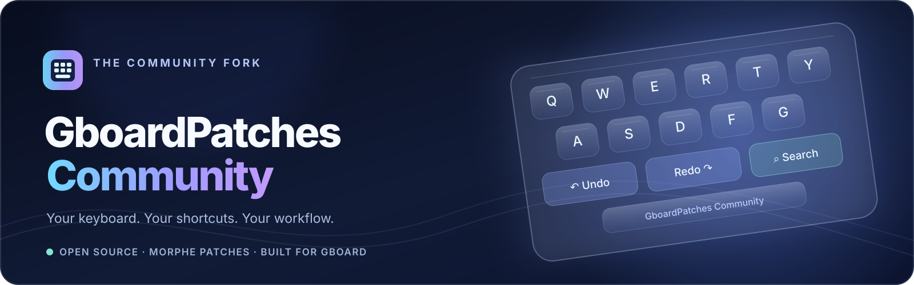

<p align="center">
  
</p>

<p align="center">
  <a href="https://github.com/igorcv88/GboardPatches-Community/releases/latest"></a>
  <a href="https://github.com/igorcv88/GboardPatches-Community/actions/workflows/validate-patch-bundle.yml"></a>
  
  
  <a href="https://github.com/igorcv88/GboardPatches-Community/releases"></a>
  <a href="https://github.com/igorcv88/GboardPatches-Community/stargazers"></a>
  <a href="LICENSE"></a>
</p>

<p align="center">
  <strong>A community-maintained Morphe patch collection for a more capable, customizable Gboard.</strong><br />
  Clipboard search · Native-style editing · Smarter shortcuts · Themes · Productivity tools
</p>

<p align="center">
  <a href="https://morphe.software/add-source?github=igorcv88/GboardPatches-Community"><strong>➕ Add to Morphe</strong></a>
  &nbsp;·&nbsp;
  <a href="https://github.com/igorcv88/GboardPatches-Community/releases/latest">Latest release</a>
  &nbsp;·&nbsp;
  <a href="https://github.com/igorcv88/GboardPatches-Community/issues">Report an issue</a>
</p>

> [!IMPORTANT]
> This is an independent community fork, not an official Google product and not affiliated with Google or the Gboard team. Patches modify a specific Gboard APK; newer versions are **not automatically compatible**. See [Compatibility](#compatibility) before patching or updating.

## What's exclusive to this Community fork?

The focus of this fork is a smoother everyday typing workflow, with dedicated improvements to Gboard's clipboard and editing controls. These features build on the original project and are documented **before** the inherited patch catalog.

| Community enhancement | What it adds |
| --- | --- |
| **🔎 Search inside clipboard history** | A search button and filtered clipboard results displayed **above the QWERTY keyboard**. Search while typing, scroll the results, tap a clip to paste, or use the back arrow to leave search. |
| **↶ Undo & ↷ Redo in the toolbar** | Custom editing actions alongside Select All, Copy, Cut, and Paste. The Community Undo path also handles **text pasted into the editor**, rather than only ordinary character entry. |
| **🧩 Context-aware quick toolbar** | Editing controls integrated into Gboard's access-point toolbar, including compact, customizable actions and support for the active editor context. |
| **📋 Clipboard-oriented Termux workflow** | A contextual Paste suggestion in Termux, designed to avoid cluttering its keyboard toolbar with unrelated editing controls. |
| **🛠️ Community compatibility work** | Gboard 18.0.3-specific runtime bindings, touch handling, regression tests, and patch-bundle validation for the Community editing and search features. |
| **🌍 Streamlined patch catalog** | The four standalone Zhuyin-specific patches from the upstream catalog are excluded from this fork's published source. General Gboard language support is preserved. |

**On-device validation:** the Community clipboard-search interaction and custom Undo were exercised on a Galaxy S25 Ultra running Android 17 with Gboard `18.0.3.954559732`. That validation does not guarantee identical behavior on every editor, phone, or other Gboard build.

## Features

### Custom features and extensions

These patches add functionality beyond simply turning on a hidden Gboard flag. Some originated upstream; the clipboard search and editing integrations above are Community improvements.

| Category | Included capabilities |
| --- | --- |
| **Clipboard** | Configurable retention and history limits, preview length and column count, creation-time/countdown labels, item numbering, optional 1,000-character card previews, clipboard history search, and a configurable per-clip character limit. |
| **Editing & navigation** | Toolbar Select All / Undo / Copy / Cut / Paste / Redo actions, optional long-press shortcuts, English QWERTY up-flick uppercase, an adjustable globe-key switch delay, and a swipeable custom top row with text/JavaScript slots. |
| **Themes & layout** | ZIP theme import, official Rboard theme browsing, Frosted Glass blur/transparency, separately adjustable panel corner radii, optional G logo on the spacebar, and drag-and-drop ordering of emoji/sticker/GIF tabs. |
| **Local connectivity** | Phone-hosted Web Clipboard with browser access, pairing code, and optional Quick Settings tile; LAN FTP server with configurable access, read-only mode, transfer/resume support, and optional Quick Settings tile. |
| **Tools & workflow** | Floating Web Search, a suggestion-bar calculator, manual Incognito toggle with clipboard/voice preferences, and configurable top-toolbar item count. |
| **Settings & recovery** | Selective JSON settings backup/restore, Gboard PB/XML flag-store backup/compare/restore, and optional separate installation through package rename. |

<details>
  <summary><strong>More about clipboard and editing</strong></summary>

  - **Clipboard Enhancements:** adjust how long clips remain available, how many appear, how much text a card previews, and whether timestamps, countdowns, or order numbers are shown. Grid columns are configurable.
  - **Clipboard Search:** the search panel stays above the keyboard and filters the existing clipboard history without replacing the normal keyboard. It is part of the Clipboard Enhancements patch.
  - **Toolbar Editing Buttons:** enable Select All, Undo, Copy, Cut, Paste, and Redo in the access-point toolbar; organize the available actions in Gboard's toolbar UI.
  - **Long-Press Editing Shortcuts:** add direct shortcuts for common text-editing operations to supported alphabet keyboard layouts.
  - **Latin Globe Key Ignore Interval:** independently adjust the post-typing language-switch delay of the English keyboard's globe key.
  - **Swipeable Custom Top Row:** swipe horizontally to alternate between the normal first row and user-configured text or JavaScript actions.
  - **Simple Calculator:** type an arithmetic expression and see the result in the suggestion strip; tap to insert or long-press to copy.
</details>

<details>
  <summary><strong>More about themes, device tools and backups</strong></summary>

  - **Custom Theme:** import ZIP themes and browse themes from the official Rboard repository.
  - **Frosted Glass:** live keyboard background blur and custom-theme transparency on Android 12+ devices with supported cross-window blur.
  - **Rounded Keyboard Panel:** select corners and independently adjust top/bottom curvature.
  - **Web Clipboard:** access clipboard exchanges from a browser on the same local network, with a pairing gate. An optional Quick Settings tile can control access.
  - **FTP Server:** browse, upload, download, and resume transfers using a local FTP client; configure credentials, ports, folder root, and read-only access.
  - **Backup & Restore:** export patch preferences as JSON, restore selected modules, and inspect/restore Gboard's own PB/XML flag-store files.
</details>

### Gboard feature unlocks

These patches expose existing Gboard behaviors, settings or rollout gates. Some require additional support from the installed Gboard build or Google's services; enabling a switch does not guarantee that a server-backed feature will become available.

| Group | Patches |
| --- | --- |
| **Writing & suggestions** | AI Writing Tools, Grammar Checker, Inline Suggestions / Smart Compose, Inline Autofill Suggestions, Close Proactive Suggestions, Quick Insert. |
| **Voice & recognition** | Advanced Voice Typing with automatic punctuation, Bluetooth Microphone support, OCR / Scan Text. |
| **Typing & accessibility** | Cursor Trackpad and lock mode, Split Keyboard, Accessibility Layout, Hyperspeed Typing Animation. |
| **Appearance & controls** | Emoji Size, Key Shape Selection, Access Points Menu Style, Settings Homepage Override. |
| **Advanced options** | Developer Options and Flag Editor, Package Rename with custom display name, Gboard Signature Bypass. |

The Bluetooth microphone switch is under **Voice typing → Use Bluetooth microphone**. **OCR / Scan Text** exposes text recognition; available models and backends depend on the Gboard build and Google Play services.

The included patch names, default selections, and compatibility targets are defined by the [published patch registry](patches/src/main/kotlin/dev/jason/gboardpatches/patches/gboard/registry/GboardPatchRegistry.kt). Not every patch must be enabled; choose the functionality you want when building the APK.

### Web Clipboard preview

<p align="center">
  
  &nbsp;
  
</p>

## Installation

This project publishes a **Morphe patch source** (`.mpp`), not a ready-to-install modified Gboard APK.

1. Install [Morphe](https://morphe.software/) and open its **Sources** screen.
2. Add this fork with **[Add to Morphe](https://morphe.software/add-source?github=igorcv88/GboardPatches-Community)** or choose **Sources → + → Remote** and enter:

   ```text
   https://github.com/igorcv88/GboardPatches-Community
   ```

3. Select the Community patch source and a **compatible Gboard APK**. Choose the patches you want and apply them with Morphe.
4. Install the patched APK using Morphe's installation flow. If installing it alongside the official Gboard, use the **Package Rename** patch.
5. Open Gboard's settings and configure the newly available features.

You can also browse the [latest release](https://github.com/igorcv88/GboardPatches-Community/releases/latest) and its patch bundle metadata. Updating the Morphe source **does not automatically update your installed keyboard**: patch and install a compatible APK again when you want a newer build.

> [!CAUTION]
> Keep a backup of Morphe's APK signing key before reinstalling Morphe, clearing its data, or replacing an existing patched installation. A different signing key can prevent an in-place update. See the [release and installation notes](docs/COMMUNITY_RELEASE.md).

## Compatibility

- **Verified Gboard target:** `18.0.3.954559732`, including Community clipboard-search and editing testing on a Samsung Galaxy S25 Ultra / Android 17.
- **Other Gboard versions:** do not assume support. Morphe checks the compatibility declared by the current patch bundle; use the exact targets advertised by the source.
- **Android version:** availability of individual features varies. Frosted Glass requires Android 12+ **and** system support for cross-window blur.
- **Editor behavior:** Undo/Redo and selection commands depend partly on the text editor's supported history and input APIs. Test critical workflows in the apps you use.
- **Network features:** Web Clipboard and FTP operate over the local network. Enable them only when needed, use their pairing/authentication options, and avoid exposing their ports to the public internet.

This is a Gboard APK patching project, **not** an LSPosed module. Gboard updates may change internal APIs even when the visible keyboard looks the same.

## Build from source

The patcher libraries are resolved through Morphe's GitHub Packages registry. Configure credentials with package-read access using either:

- `gpr.user` and `gpr.key` in your Gradle user properties (`~/.gradle/gradle.properties`), or
- `GITHUB_ACTOR` and `GITHUB_TOKEN` environment variables.

Build the patch bundle and regenerate source metadata:

```bash
./gradlew :patches:buildAndroid
./gradlew generatePatchesList
```

On Windows, use `gradlew.bat` instead of `./gradlew`.

| Output | Purpose |
| --- | --- |
| `patches/build/libs/*.mpp` | Importable Morphe patch bundle |
| `patches-list.json` | Published patch inventory |
| `patches-bundle.json` | Remote source metadata (also distributed with releases) |

Pull requests are checked by the [patch bundle validation workflow](.github/workflows/validate-patch-bundle.yml), which runs relevant tests, builds the `.mpp`, and checks that the final bundle can be imported. Stable publication is handled by the [release workflow](.github/workflows/release.yml).

## Documentation & support

- [Release management and Morphe source setup](docs/COMMUNITY_RELEASE.md)
- [Community editing implementation](docs/COMMUNITY_EDITING_IMPLEMENTATION.md)
- [Clipboard search and touch diagnostics](docs/validation/native-clipboard-search.md)
- [Regional catalog policy](docs/validation/regional-catalog.md)
- [Report bugs or suggest improvements](https://github.com/igorcv88/GboardPatches-Community/issues)

For a bug report, include your Gboard version, Android version, selected patches, steps to reproduce, and relevant logs **without private clipboard contents or credentials**.

## License, credits & disclaimer

Licensed under the [GNU General Public License v3.0](LICENSE). Maintained as a community fork by [igorcv88](https://github.com/igorcv88).

Based on the original [jasonwu1994/Gboard-patches](https://github.com/jasonwu1994/Gboard-patches) project by Jason Wu and contributors. Original attribution, copyrights, and license obligations are preserved. You can [support the upstream maintainer on Ko-fi](https://ko-fi.com/jasonwu1994).

**Gboard** and **Google** are trademarks of Google LLC. This repository is an independent open-source modification project and is not endorsed by Google. Use modified APKs at your own discretion and keep backups of your working installation.
